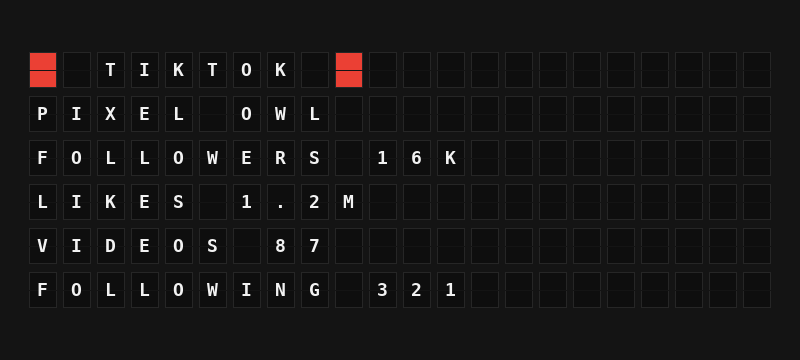

# TikTok Plugin

Show your TikTok follower, following, like and video counts on your board.



**→ [Setup Guide](./docs/SETUP.md)**

## Overview

The TikTok plugin reads your own account's display name and counts through TikTok's v2 user info API and turns them into board-ready variables, with shortened forms (`16K`, `1.2M`) that fit the board.

You sign in once with FiestaBoard's **Sign in with TikTok** button. TikTok has no shared FiestaBoard app, so you create your own free TikTok developer app (Sandbox mode is enough for your own account) and enter its Client key and Client secret in the plugin's **Account connection** section. Requires FiestaBoard 9.9.0 or later.

## Template Variables

### Account

| Variable | Description | Example |
|----------|-------------|---------|
| `{{tiktok.display_name}}` | Your TikTok display name (`TIKTOK` if it has no letters the board can show) | `PIXEL OWL` |

### Stats

| Variable | Description | Example |
|----------|-------------|---------|
| `{{tiktok.followers}}` | Follower count | `15600` |
| `{{tiktok.followers_short}}` | Follower count shortened | `16K` |
| `{{tiktok.following}}` | How many accounts you follow | `321` |
| `{{tiktok.following_short}}` | Following count shortened | `321` |
| `{{tiktok.likes}}` | Total likes across your videos | `1234567` |
| `{{tiktok.likes_short}}` | Total likes shortened | `1.2M` |
| `{{tiktok.videos}}` | How many videos you have posted | `87` |
| `{{tiktok.videos_short}}` | Video count shortened | `87` |
| `{{tiktok.followers_line}}` | `FOLLOWERS` and the shortened count | `FOLLOWERS 16K` |
| `{{tiktok.likes_line}}` | `LIKES` and the shortened count | `LIKES 1.2M` |
| `{{tiktok.summary}}` | Followers and likes on one line | `16K FANS 1.2M LIKES` |

A count TikTok leaves out (for example when the stats permission was not granted) is empty rather than `0`.

## Example Templates

Account stats (Flagship):

```jinja
{63} TIKTOK {63}
{{tiktok.display_name}}
FOLLOWERS {{tiktok.followers_short}}
LIKES {{tiktok.likes_short}}
VIDEOS {{tiktok.videos_short}}
FOLLOWING {{tiktok.following_short}}
```

Note:

```jinja
{63} {{tiktok.display_name}}
{{tiktok.followers_line}}
{{tiktok.likes_line}}
```

One line inside another page:

```jinja
{63} {{tiktok.summary}}
```

## Configuration

| Setting | Type | Required | Default | Description |
|---------|------|----------|---------|-------------|
| `enabled` | boolean | No | `false` | Enable the plugin |
| `client_id` | string | To sign in | | **Client Key** of your own TikTok app. Entered in **Account connection** |
| `client_secret` | string | To sign in | | **Client Secret** of that app. Entered in **Account connection**; stored on your board and sent only to TikTok's token endpoint |
| `refresh_seconds` | integer | No | `900` | How often to ask TikTok for your counts (300-86400) |

The sign-in itself is not a setting: press **Sign in with TikTok** in the plugin's **Account connection** section. The manifest's `oauth` block declares TikTok's authorization code flow through FiestaBoard's redirect relay, sends the client ID as TikTok's `client_key` parameter (`client_id_param`), and joins scopes with commas (`scope_separator`). It asks for two read-only scopes:

| Scope | Used for |
|-------|----------|
| `user.info.basic` | `display_name` from `GET /v2/user/info/` |
| `user.info.stats` | `follower_count`, `following_count`, `likes_count`, `video_count` from the same request |

No environment variables: the Client key and secret live in the plugin settings because the platform reads them from there.

## Features

- Signs in through your own TikTok app with FiestaBoard's guided setup; FiestaBoard stores and refreshes the tokens (TikTok access tokens last 24 hours, refresh tokens 365 days) and the plugin asks for the current one on every refresh
- One request per refresh for the name and all four counts, shared by every board showing the plugin
- Shortened counts (`1.2K`, `16K`, `1.2M`) and ready-made lines that fit a Flagship or a Note
- Backs off after rate limits, outages, timeouts and rejected sign-ins instead of retrying on every render. During an outage the board keeps the last counts (up to an hour old)
- Clear messages when the sign-in is rejected or the stats permission is missing
- Works on every board shape: Flagship, Note, and Note arrays

## Author

FiestaBoard Team
